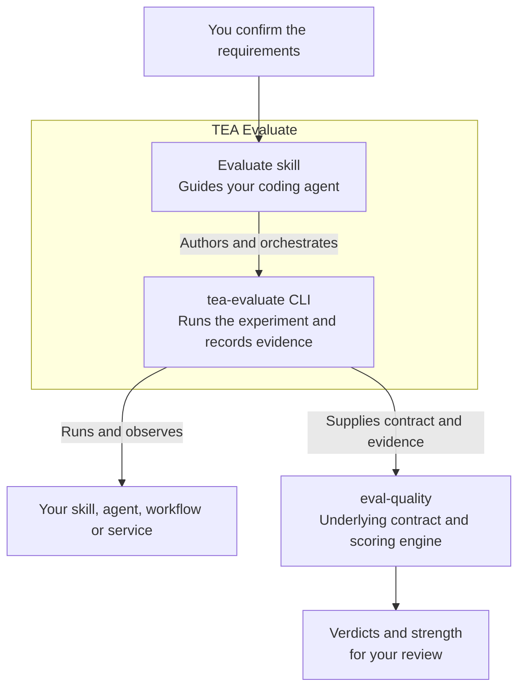
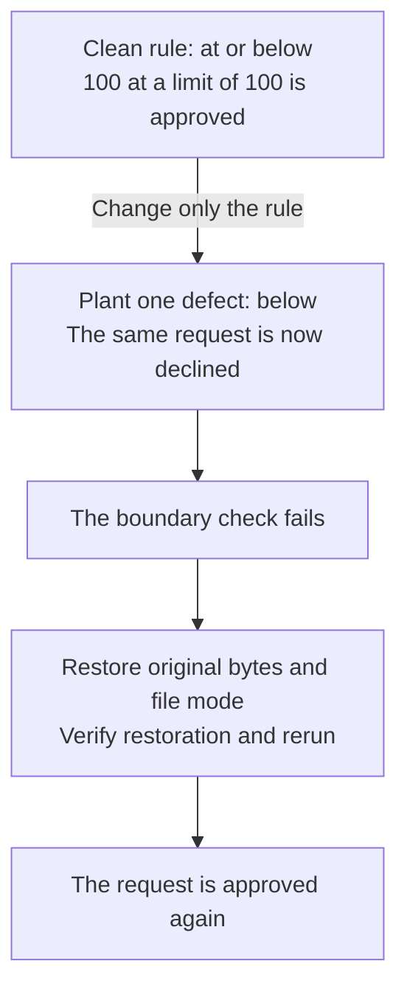

# How Evaluate Works

Evaluate tests whether your evaluation deserves trust. A green result means little unless the same evaluation catches deliberate failures. The workflow is: define correctness, establish a reliable measurement, plant a failure, measure detection, and preserve the evidence.

You start Evaluate (`bmad-tea-evaluate`, menu code `EV`) in your coding agent. Its skill guides the agent through authoring and running the evaluation. The `tea-evaluate` CLI manages execution and evidence; the underlying [`eval-quality` engine](https://github.com/bmad-code-org/bmad-eval-quality) checks the contract, applies its evidence rules, and produces formal verdicts and strength measurements.

Five questions explain what that gives you:

1. [Who decides what is correct?](#1-who-decides-what-is-correct)
2. [What executes, and what can it access?](#2-what-executes-and-what-can-it-access)
3. [What makes the evidence trustworthy?](#3-what-makes-the-evidence-trustworthy)
4. [When does Evaluate refuse to continue?](#4-when-does-evaluate-refuse-to-continue)
5. [What does a pass prove?](#5-what-does-a-pass-prove)

## One workflow

The skill and CLI are parts of the same Evaluate workflow. The skill guides design and interpretation; the CLI handles repeatable execution mechanics, mutation rollback, evidence recording and CI checks. It delegates formal scoring to `eval-quality`, which can also be used independently of TEA. Model-driven targets and evaluators can still vary between runs.

## 1. Who decides what is correct?

You do. The skill inspects the target and drafts requirements for you to confirm: expected behavior, important boundaries, admissible evidence, permitted resources and failures worth catching. The evaluated target is your use of a model, skill, agent, workflow or service, including the prompts and wiring you control.

Those requirements become a **Behavioral Evaluation Contract**: what must hold, how to observe it, which interfaces may be used, and which checks decide the outcome. An **oracle** is an assertion over evidence, such as “the refund decision is approved when the amount equals the limit.” The **evaluator** applies those assertions or supplies evidence-backed judgments.

The default evaluator uses deterministic oracle resolution. Alternatives include your own command, an agent working from a sealed brief, or records supplied by an existing harness. An agent evaluator must qualify through repeated attempts. Judgment-heavy criteria use anchored rubrics; a model judge must agree sufficiently with your human-labeled examples before its trial scores count.

The engine checks the contract's structure and discipline. You remain responsible for whether the requirements capture the right behavior. See [eval-quality's contract explanation](https://github.com/bmad-code-org/bmad-eval-quality/blob/main/docs/explanation/behavioral-evaluation-contracts.md) and [evaluator options](/docs/reference/tea-evaluate-evaluators.md#the-evaluation-layer).

## 2. What executes, and what can it access?

The CLI coordinates the target, evaluator and any judge through the configured registry and adapters. The registry names permitted commands, tool servers or HTTP targets, alongside their resource and environment settings. Locally executed target arms get a fresh disposable workspace for each trial; an external harness supplies its own records. A sealed evaluator brief withholds answer-revealing contract details.

Confinement is enabled by default on supported macOS and Linux hosts. It restricts target writes, protects evaluation files and audits access outside the granted paths. It also provides runtime-managed temporary and home directories. This is a configured boundary with platform-specific limits: the target still needs system and toolchain access, and explicit confinement opt-out is supported and recorded. A required confinement mechanism or audit that cannot operate stops the run.

The committed evaluation folder holds the confirmed requirements, contract, probes, mutations, policy and accepted baseline. Run records preserve what happened under that configuration. See [the folder reference](/docs/reference/tea-evaluate-cli.md#the-evaluation-folder) and [why Evaluate confines the target](/docs/explanation/why-evaluate-confines-the-target.md) for the implementation details.

## 3. What makes the evidence trustworthy?

Start with a small example from [Evaluate Your First Skill](/docs/tutorials/evaluate-your-first-skill.md). A refund skill should approve an amount **at or below** the limit. The probe asks for a refund of 100 against a limit of 100.

This is the qualification sequence. The clean behavior must satisfy the oracle; the deliberate change must break it; restoration must recover both the file and the clean behavior. If the edit does not produce the expected wrong behavior, qualification stops: it has not established a usable defect to test. Merely observing a successful process exit would miss a wrong refund decision.

After qualification, the run repeats the required clean and defective variants, called **arms**, in fresh workspaces. If the evaluator reports the broken behavior as correct despite a qualified defect, it has a blind spot. Historical probes can instead exercise a real defect across its fix, using revisions or deployments. Clean controls check for false alarms.

A finding needs a recorded observation and quoted evidence. The runtime checks record structure, citations and digests; `eval-quality` checks whether the evidence supports the finding and matches the declared defect signature. A claim that “the defect was caught” earns no credit by itself. Failed preflight or invalid evidence cannot establish detection.

**Gameability probes** test a different weakness: a committed, compliant-looking response that does no meaningful work. A naive oracle must accept it while the disciplined oracle rejects it. This arm uses the committed response without launching the target. Zero-action defect probes test omission of a required action despite a success claim.

## 4. When does Evaluate refuse to continue?

Stopping can reveal a problem with the evaluation or its environment. It does not automatically mean the target is defective.

- **The evaluation is malformed:** missing requirements, invalid evidence references, inconsistent records or stale digests must be fixed before scoring.
- **The evaluation cannot distinguish good from bad:** a mutation does not produce the expected distinction, a clean control fails, or judge/evaluator agreement falls below the declared minimum.
- **The measurement cannot be trusted:** preflight fails, required infrastructure cannot run, restoration cannot recover the clean baseline, or evidence integrity or isolation checks fail.

TEA enforces its execution and admission checks; `eval-quality` owns the formal contract verdicts and strength rules. Both can stop the workflow. The [exit-code reference](/docs/reference/tea-evaluate-cli.md#exit-codes) distinguishes authoring defects, evaluation weaknesses, invalid measurements and infrastructure failures.

## 5. What does a pass prove?

Read the result at three levels:

- **Detection:** did this probe catch its declared defect?
- **Evaluation verdict:** was the measurement sound and complete enough under the contract and policy?
- **Strength:** how many distinct qualified probes were caught in each class across the run?

Evaluate's generated runs use **contract-scoring** mode. A correctly caught defect can contribute to a `PASS` for the evaluation even though the deliberately broken target behaved incorrectly. Other evidence faults or coverage gaps can still prevent that pass. A zero exit is also broader than `PASS`: scoring can return `WAIVED` or `CONCERNS` with zero.

Strength is reported separately for defect, gameability and zero-action probes. Repeated trials reduce to one result per probe; clean controls and canaries do not inflate the catch rate. A perfect result on known probes does not establish exhaustive coverage or production reliability. See [eval-quality's Contract Strength explanation](https://github.com/bmad-code-org/bmad-eval-quality/blob/main/docs/explanation/contract-strength.md).

Held-out probes help limit tuning to examples already seen. Evaluate's gap view reveals only their identifiers, classes and outcomes. A partition plan can also separate held-out requests from development runs; without it, filtering scored probes alone does not separate the requests. Repeated feedback can still influence later changes, so a held-out pass is bounded evidence, not a guarantee of independent generalization.

After review, you accept and commit a baseline. That preserves the measurement you accepted so later runs can expose changes. It does not certify the product as correct.

## Carrying the evidence into CI

The skill derives a CI plan from your repository, workflow events, secrets and release process. Model-free deterministic checks, including contract validation, gameability checks and baseline replay, belong on the `pr` tier. Live target runs, judge calibration, held-out execution and strength comparisons belong on `merge`, `scheduled` or `release` tiers. The CLI rejects invalid placement and runs each tier's blocking policy. CI setup must wire that plan into your pipeline before those checks can gate changes or releases.

Start with [Evaluate Your First Skill](/docs/tutorials/evaluate-your-first-skill.md). Use the [CLI reference](/docs/reference/tea-evaluate-cli.md) for commands and fields, [Setup CI](/docs/how-to/workflows/setup-test-framework.md#evaluation-plans) to wire the plan into your pipeline, and [How TEA Is Tested](/docs/explanation/how-tea-is-tested.md) for the checks behind Evaluate itself.
