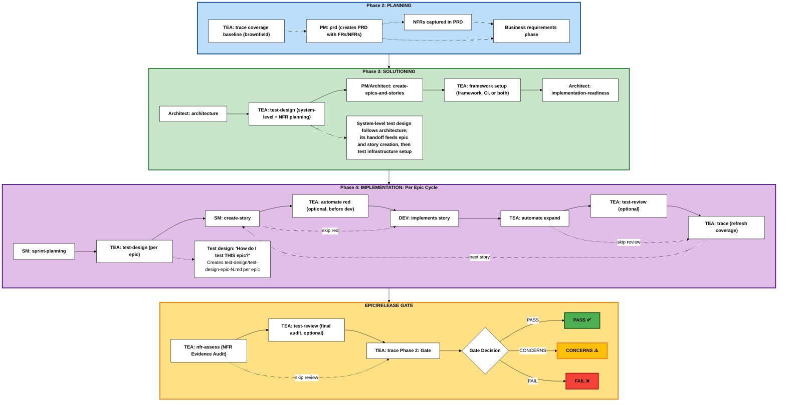

The Test Architect (TEA) plans tests, builds automation, and evaluates release evidence.
You can use it with BMad Method or on its own.

:::tip[Design Philosophy]
TEA was built to solve AI-generated tests that rot in review.
For the problem statement and design principles, see [Testing as Engineering](/docs/explanation/testing-as-engineering.md).
For setup, see [Setup Test Framework](/docs/how-to/workflows/setup-test-framework.md).
:::

:::note[Scope]
TEA's risk, design, NFR, traceability, and gate skills are stack-neutral and apply to any system under test.
Execution support varies by stack: browsers, HTTP services, contracts, and mobile native (Maestro) are covered end to end, while other stacks are covered at shallower tiers.
[Verification Architecture](/docs/explanation/verification-architecture.md) explains the split; [Execution Targets](/docs/reference/execution-targets.md) publishes the per-target matrix and the known gaps.
:::

## Overview

- **Persona:** Murat, Master Test Architect and Quality Advisor focused on risk-based testing, fixture architecture, ATDD, and CI/CD governance.
- **Mission:** Plan coverage, generate tests, and make gate decisions from project evidence.
- **Use When:** BMad Method or Enterprise track projects, integration risk is non-trivial, brownfield regression risk exists, or compliance/NFR evidence is required. (Quick Flow projects typically don't require TEA)

Choose an adoption path in [Engagement Models](/docs/explanation/engagement-models.md).
TEA runs in solutioning, implementation, and release gates; the Enterprise track adds compliance evidence.

<a id="tea-command-catalog"></a>

## TEA Skill Catalog

Eight workflows have eight direct capability commands, plus the TEA agent and its module record. The table follows the sidebar order, with Evaluate last:

| Skill                                                          | Primary Outputs                                                                                                      | Browser Automation (CLI/MCP)                                      |
| -------------------------------------------------------------- | -------------------------------------------------------------------------------------------------------------------- | ----------------------------------------------------------------- |
| [Automate](/docs/how-to/workflows/run-automate.md)             | Red acceptance scaffolds and implementation checklist; expand-mode specs, fixtures, README, and DoD summary          | Recording for skeleton UI in red; healing and recording in expand |
| [Test Review](/docs/how-to/workflows/run-test-review.md)       | Test quality report with 0-100 score, violations, and fixes                                                          | Traces, screenshots, and network evidence                         |
| [Test Design](/docs/how-to/workflows/run-test-design.md)       | Risk assessment, NFR thresholds and evidence plan, mitigation plan, and coverage strategy                            | Exploratory UI discovery                                          |
| [Framework](/docs/how-to/workflows/setup-test-framework.md)    | Stack-specific scaffold, CI pipeline, selective testing scripts, secrets checklist, and evaluation jobs as requested | No browser automation required                                    |
| [NFR](/docs/how-to/workflows/run-nfr-assess.md)                | NFR evidence audit against thresholds, domain statuses, and actions                                                  | Optional evidence capture                                         |
| [Trace](/docs/how-to/workflows/run-trace.md)                   | Phase 1 coverage matrix and recommendations; Phase 2 gate decision (PASS/CONCERNS/FAIL)                              | Consumes recorded live verification                               |
| [Teach Me Testing](/docs/how-to/workflows/teach-me-testing.md) | Seven learning sessions, quizzes, notes, and saved learner progress                                                  | No browser automation required                                    |
| [Evaluate](/docs/tutorials/evaluate-your-first-skill.md)       | Scored behavioral evaluation, named gaps, and a CI plan handed to Framework with CI scope                            | No browser automation required                                    |

<a id="additional-skills"></a>

Automation uses one skill with two modes: red before implementation and expand after implementation. Request red mode through Automate for acceptance tests before implementation. Automate and `TA` default to expand when no task mode is given. Create runs execute and repair tests for up to three rounds while keeping real product defects visible.

Invoke a skill as `/bmad-tea-<skill>` in Claude Code, Cursor, and Windsurf, or `$bmad-tea-<skill>` in Codex.
NFR uses `/bmad-tea-nfr` or `$bmad-tea-nfr`; its stored identifier is `nfr-assess`. Teach Me Testing uses `/bmad-tea-teach-me-testing` or `$bmad-tea-teach-me-testing`, with no `testarch` segment.
Inside an active TEA agent session, use the menu codes: `TD`, `TF`, `CI`, `AT`, `TA`, `EV`, `RV`, `NR`, `TR`, plus `TMT` for TEA Academy and `GATE`. `AT` selects Automate red mode; `CI` selects Framework CI scope.

`bmad-tea-framework` owns both setup phases.
Request framework only, CI only, or both. It infers scope from the prompt and asks "Do you want CI too?" once when CI scope is unclear in an interactive session. An unattended request with unclear scope runs framework setup only and states that CI was excluded.
Request CI setup through `bmad-tea-framework` with CI scope or use the agent's `CI` menu code.
Create starts setup, Resume continues an interrupted run, Validate reports checks without repairing outputs, and Edit revises the selected outputs and checks those changes.

<a id="tea-workflow-lifecycle"></a>

## TEA Skill Lifecycle

BMad uses a 4-phase methodology with an optional Phase 1 and a documentation prerequisite:

- **Documentation** (optional, brownfield): prerequisite using `document-project`
- **Phase 1** (optional): discovery and analysis (`brainstorm`, `research`, `product-brief`)
- **Phase 2** (required): planning (`prd` creates the PRD with FRs and NFRs)
- **Phase 3** (track-dependent): solutioning (`architecture` → `test-design` system-level → `create-epics-and-stories` → TEA `framework` (framework and CI scope) → `implementation-readiness`)
- **Phase 4** (required): implementation (`sprint-planning` → per-epic `test-design` → per-story dev workflows)

The Quick Flow track skips Phases 1 and 3.
BMad Method and Enterprise use all phases based on project needs.



Solid arrows show the recommended order. Few are hard prerequisites: system-level `test-design` needs the PRD and architecture, and `automate` red mode needs a story with acceptance criteria and a configured framework. `trace` reads an NFR audit when one exists and never needs `test-review`.

TEA's Phase 2 work is the Brownfield baseline: run `trace` Phase 1 during planning to record existing coverage.
Greenfield projects start TEA in Phase 3.
The Phase 3 skills run once per project, the Phase 4 skills run per epic and per story, and the gate skills run per epic or per release.
`teach-me-testing` sits outside the lifecycle entirely and runs once per learner.
Evaluate sits outside it too: `bmad-tea-evaluate` needs only the target and the requirements you confirm, so it runs at any point.

In Phase 3, run `test-design` before `framework` so you can carry its NFR evidence needs into the framework request; `framework` itself needs only the project's stack. Request both setup phases to agree the stack, framework, and test commands, then it can generate the scaffold and pipeline in parallel before validating them together. A CI-only request with no framework offers the framework phase first.

### `test-design` is dual-mode

Both modes use the same skill command.
Make the scope explicit in your prompt.

- **System-level (Phase 3):** run immediately after architecture/ADR drafting.
  Produces `test-design/test-design-architecture.md` (for Architecture and Dev: testability gaps, ASRs, NFR requirements, planned evidence) and `test-design/test-design-qa.md` (for QA: test execution recipe, coverage plan, Sprint 0 setup, NFR coverage plan).
  Feeds the implementation-readiness gate.
  When an ADR or architecture draft is produced, run this before that gate so the ADR carries a testability review and an ADR → test mapping, and keep it updated if ADRs change.
- **Epic-level (Phase 4):** run per epic.
  Produces `test-design/test-design-epic-N.md` with risk, priorities, coverage plan, and epic-specific NFR planning when relevant.

#### Phase 3 system-level example

```text
/bmad-tea-test-design
Run system-level test-design for Phase 3 using docs/prd.md, docs/architecture.md, and docs/adr/*.md. Focus on architecture testability, ASRs, NFR thresholds, planned NFR evidence, integration risks, and Sprint 0 setup. Produce test-design/test-design-architecture.md and test-design/test-design-qa.md before implementation-readiness.
```

#### Phase 4 per-epic example

```text
/bmad-tea-test-design
Run epic-level test-design for Phase 4 on Epic 3 using docs/epics/epic-3.md and its stories. Use prior system-level test-design outputs if present. Produce test-design/test-design-epic-3.md with risk scores, P0-P3 scenarios, regression/integration/NFR coverage, and follow-on guidance for Automate red and expand modes.
```

Codex users run `$bmad-tea-test-design` with the same scope-setting prompt.

## Why TEA Is Different from Other BMM Agents

TEA spans the brownfield baseline in Phase 2, Phases 3 and 4, and the release gate.
Its skills share testing, fixture, and CI patterns through the [Knowledge Base System](/docs/explanation/knowledge-base-system.md).

## Optional Integrations

TEA works without any of these.
Each one changes what TEA generates or checks once enabled, and its setup guide owns the install commands and configuration.
The `library-integration-mandate` knowledge fragment defines the shared rule: a library is used when its flag is `true` and its package is installed, and `false` generates code on the underlying framework.

| Integration                                 | What it enables                                                                                                                                            | Setting                                                          | Setup                                                                                                                                                                                               |
| ------------------------------------------- | ---------------------------------------------------------------------------------------------------------------------------------------------------------- | ---------------------------------------------------------------- | --------------------------------------------------------------------------------------------------------------------------------------------------------------------------------------------------- |
| Playwright Utils                            | Shared Playwright fixtures for API requests, authentication, network handling, and polling in Framework, Automate, and Test Review                         | `tea_use_playwright_utils`                                       | [Integrate Playwright Utils](/docs/how-to/customization/integrate-playwright-utils.md)                                                                                                              |
| Pact.js Utils                               | Provider-state, verifier, and request-filter helpers in contract tests from Framework, Automate, Test Design, and Test Review                              | `tea_use_pactjs_utils` (needs a real consumer-provider boundary) | [Integrate Pact.js Utils](/docs/how-to/customization/integrate-pactjs-utils.md#install-and-verify)                                                                                                  |
| Browser automation (Playwright CLI and MCP) | Live page discovery in Test Design, selector verification in Automate, and trace, screenshot, and network evidence in Test Review                          | `tea_browser_automation` (`auto`, `cli`, `mcp`, `none`)          | [Configure Browser Automation](/docs/how-to/customization/configure-browser-automation.md)                                                                                                          |
| Pact MCP (SmartBear)                        | Broker-aware provider-state discovery, review support, and can-i-deploy checks in contract skills; complements `pactjs-utils`, which runs inside test code | `tea_pact_mcp` (`mcp` or `none`)                                 | [Pact MCP](/docs/how-to/customization/integrate-pactjs-utils.md#pact-mcp-tea_pact_mcp) and [Configure Browser Automation](/docs/how-to/customization/configure-browser-automation.md#cli-shortcuts) |

`bmad setup tea` asks about each setting; run it again, or edit `[modules.tea]` in `_bmad/config.toml`, to change an answer.
See [Configuration](/docs/reference/configuration.md) for every setting.

## Related

- [Testing as Engineering](/docs/explanation/testing-as-engineering.md): why TEA exists, and the three-part stack
- [Verification Architecture](/docs/explanation/verification-architecture.md): stack-neutral vs execution target split
- [How TEA Is Tested](/docs/explanation/how-tea-is-tested.md): how TEA proves its own behavior with deterministic checks and live evals
- [Engagement Models](/docs/explanation/engagement-models.md): the five ways to adopt TEA
- [Risk-Based Testing](/docs/explanation/risk-based-testing.md): probability × impact scoring and P0-P3
- [Test Quality Standards](/docs/explanation/test-quality-standards.md): the Definition of Done and the 100-point rubric
- [Knowledge Base System](/docs/explanation/knowledge-base-system.md): context engineering with `tea-index.csv`
- [TEA Command Reference](/docs/reference/commands.md): inputs, outputs, phases, and frequency per skill
- [Evaluate Your First Skill](/docs/tutorials/evaluate-your-first-skill.md): tutorial: score one skill from requirements to an accepted baseline
- [How Evaluate Works](/docs/explanation/how-evaluate-works.md): the stack, the rules, and the reasons behind an evaluation
- [Why Evaluate Confines the Target](/docs/explanation/why-evaluate-confines-the-target.md): why the target of an evaluation runs under file-system confinement
- [tea-evaluate CLI](/docs/reference/tea-evaluate-cli.md): every `tea-evaluate` command, option, and exit code; companions: [tea-evaluate Manifest](/docs/reference/tea-evaluate-manifest.md), [tea-evaluate Confinement](/docs/reference/tea-evaluate-confinement.md), [tea-evaluate Evaluators](/docs/reference/tea-evaluate-evaluators.md) and [tea-evaluate Evidence](/docs/reference/tea-evaluate-evidence.md)
- Evaluate how-to guides: [Evaluate a Skill or Agent](/docs/how-to/evaluate/evaluate-a-skill-or-agent.md), [Evaluate an MCP Tool Server](/docs/how-to/evaluate/evaluate-an-mcp-tool-server.md), [Evaluate an HTTP API](/docs/how-to/evaluate/evaluate-an-http-api.md), [Choose an Evaluator and Calibrate a Judge](/docs/how-to/evaluate/choose-an-evaluator-and-calibrate-a-judge.md), [Read the Gaps and Fix Them](/docs/how-to/evaluate/read-the-gaps-and-fix-them.md), [Compare Runs and Accept a Baseline](/docs/how-to/evaluate/compare-runs-and-accept-a-baseline.md), [Put an Evaluation in CI](/docs/how-to/evaluate/put-an-evaluation-in-ci.md); optional advanced paths: [Measure Repeatability and Compare a Configuration](/docs/how-to/evaluate/measure-repeatability-and-compare-a-configuration.md), [Bring an Existing Suite](/docs/how-to/evaluate/bring-an-existing-suite.md)
